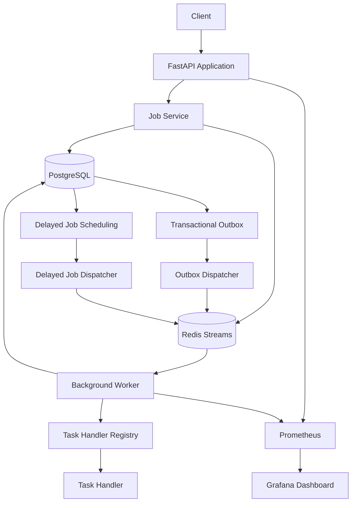

# Nexus — Distributed Task Processing Platform

A reliable asynchronous task-processing platform built with Python, FastAPI, PostgreSQL, Redis Streams and Docker. Nexus supports background job execution, retry scheduling, worker recovery, concurrency control and real-time observability.

## Overview

Nexus is designed to solve a common backend engineering problem: executing time-consuming tasks reliably without blocking API requests.

Instead of processing tasks synchronously, the API persists jobs in PostgreSQL and publishes job identifiers to Redis Streams. Independent workers consume and execute jobs asynchronously.

The platform incorporates reliability mechanisms to handle failures, retries, delayed execution and worker crashes.

## Architecture



## Technology Stack

| Category | Technologies |
|---|---|
| Language | Python |
| Backend API | FastAPI |
| Database | PostgreSQL |
| Message Streaming | Redis Streams |
| Background Processing | Python Workers |
| Containerization | Docker, Docker Compose |
| Monitoring | Prometheus |
| Visualization | Grafana |
| Testing | pytest |
| Load Testing | Locust |

## Key Features

### 1. Asynchronous Job Processing
- Submit jobs through REST APIs.
- Process jobs independently using background workers.
- Use Redis Streams consumer groups for message consumption.
- Separate API responsibilities from background execution.

### 2. Reliability and Retry Mechanism
- Automatic retry scheduling after task failures.
- Exponential backoff for retry delays.
- Maximum retry-attempt enforcement.
- Delayed job scheduling.
- Permanent failure handling.

### 3. Worker Recovery and Concurrency Control
- Worker leases and lease expiration.
- Fencing tokens to prevent stale workers from updating jobs.
- Recovery of expired jobs.
- PostgreSQL row-level locking.
- `FOR UPDATE SKIP LOCKED` for concurrent job claiming.

### 4. Transactional Outbox
- Persist job-related events in PostgreSQL.
- Dispatch events asynchronously.
- Use database-backed state to support reliable event delivery.

### 5. Observability
- Prometheus metrics for job creation, completion, failure and retries.
- Worker execution metrics.
- Job processing duration histograms.
- Grafana dashboards for monitoring application behavior.

## Project Structure

```text
task_processing_platform/
│
├── app/
│   ├── api/
│   ├── database/
│   ├── domain/
│   ├── monitoring/
│   ├── queue/
│   ├── repositories/
│   ├── services/
│   └── workers/
│
├── migrations/
├── monitoring/
│   └── prometheus/
├── tests/
├── load_tests/
├── docker-compose.yml
├── pyproject.toml
├── uv.lock
└── README.md
```

## Getting Started

### Prerequisites

- Python
- Docker Desktop
- Docker Compose
- Git
- uv package manager

## Environment Configuration

Create a `.env` file in the project root.

```env
POSTGRES_USER=task_processing_user
POSTGRES_PASSWORD=change_me
POSTGRES_DB=task_processing_db
```

Use your own strong local development password. Do not commit `.env` files or production credentials to Git.

Docker Compose uses these values to configure PostgreSQL and construct the application database connection.

## Starting the Application

Build and start the services:

```bash
docker compose up --build -d
```

Check service status:

```bash
docker compose ps
```

Database migrations are executed automatically by the migration service before the API and worker services start.

To inspect application logs:

```bash
docker compose logs -f api
docker compose logs -f worker
docker compose logs -f delayed-dispatcher
docker compose logs -f outbox-dispatcher
```

To stop the application:

```bash
docker compose down
```

To stop the application and delete persistent volumes (this deletes local database and monitoring data):

```bash
docker compose down -v
```

**Warning:** Do not use the last command if you want to preserve your local project data.

### Clone the repository

```bash
git clone https://github.com/Kushalchavan/task_processing_platform.git

cd task_processing_platform
```

### Start the application

```bash
docker compose up --build -d
```

Check the running services:

```bash
docker compose ps
```

### API Documentation

Once the API is running:

- API: http://localhost:8000
- Swagger UI: http://localhost:8000/docs
- Prometheus API metrics: http://localhost:8000/metrics

### Monitoring

- Grafana: http://localhost:3000
- Prometheus: http://localhost:9090

The worker exposes its Prometheus metrics internally on port 8001.

## API Usage

### Create a Job

**POST** `/jobs`

Example request:

```json
{
  "task_type": "print_message",
  "payload": {
    "message": "Hello from Nexus!"
  }
}
```

Example response:

```json
{
  "id": "generated-job-id",
  "task_type": "print_message",
  "payload": {
    "message": "Hello from Nexus!"
  },
  "status": "pending",
  "attempts": 0
}
```

The API returns HTTP `201 Created` when the job is successfully created.

## Testing

Run the complete test suite:

```bash
uv run python -m pytest
```

The project currently has **115 passing automated tests** covering API behavior, job lifecycle, PostgreSQL repositories, concurrency, Redis Streams, delayed dispatching, outbox processing and worker execution.

## Load Testing

Nexus uses Locust to load-test the job creation API.

Start Locust:

```bash
uv run locust -f load_tests/locustfile.py --host http://localhost:8000
```

Open:

http://localhost:8089

### Observed Local Test Results

A 2-minute test using 50 concurrent users produced:

| Metric | Result |
|---|---:|
| Total requests | 2,829 |
| Failed requests | 0 |
| Average response time | 54.93 ms |
| p95 response time | 77 ms |
| p99 response time | 140 ms |
| Throughput | 24.2 requests/sec |

These are observed local test results, not production performance guarantees. They measure job submission API behavior, not end-to-end worker throughput.

## Engineering Concepts Demonstrated

- REST API design
- Layered backend architecture
- Database transactions
- PostgreSQL concurrency control
- Asynchronous processing
- Redis Streams and consumer groups
- Exponential backoff
- Transactional outbox pattern
- Worker leases and fencing tokens
- Crash recovery
- Observability and metrics
- Automated testing
- Load testing

## Future Improvements

Potential future enhancements include:

- AWS deployment.
- CI/CD automation.
- Distributed tracing.
- Advanced queue and worker scaling.
- Additional task handlers.
- Production deployment and operational benchmarking.

## Author

**Kushal Chavan**

GitHub: https://github.com/Kushalchavan

---

*Built as a practical backend engineering project to explore reliable asynchronous processing, concurrency, distributed systems and production observability.*